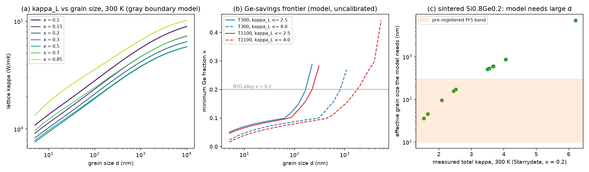

# Nanostructured SiGe + light doping: results (2026-09-29)

Pre-registered design `nano_design.json` (campaign record seq 40, commit `d8184f9`);
per-mode evidence ledgered before analysis (seq 45). CHPC notchpeak-guest
array 15891778, 9 compositions x 5 temperatures, about 4 min per
composition (28 min for the two new VCA builds). grn061 not used.
Numbers: `results/nano_results.json`; figure: `results/fig_nano.png`.

## Gates (all pass)

| Gate | Result |
|---|---|
| G1 per-mode re-summation reproduces almaBTE's own RTA kappa | max deviation 4e-6 relative over 21 (x, T) points |
| G2 dopant (Tamura) implementation sanity | Tamura on pure-Si modes with the x=0.2 mass variance gives 1.18 x almaBTE's VCA x=0.2 kappa (bound: 1/1.5 to 1.5) |
| G3 boundary limits | monotone in d everywhere; pure Si at 5 nm keeps 3.8% of bulk |

## Predictions (stated before results)

| | Prediction | Outcome |
|---|---|---|
| Pr1 | x=0.2, 300 K, d=20 nm: kappa_L in [2, 5] W/mK | **FAIL**: 1.28 W/mK |
| Pr2 | 20 nm suppression stronger at x=0.2 than x=0.5 | pass, barely (0.173 vs 0.181 of bulk) |
| Pr3 | B or P at <= 1e20 cm^-3 lowers kappa_L by < 10% in the alloy (mass only) | pass: at most 1.7% |
| Pr4 | boundary and dopant scattering not super-additive (S >= 1) | pass: S = 1.006, effectively multiplicative |
| Pr5 | effective grain size inferred from sintered Si0.8Ge0.2 (Starrydata, 11 points from 6 papers) has median in [10, 300] nm | **FAIL**: median 508 nm (range 36 nm to 7.2 um) |

## What it means for materials

1. **The textbook grain-boundary model is too strong by about an order of
   magnitude in grain size.** Pr1 and Pr5 fail the same way. A gray,
   fully diffuse boundary at d = 20 nm predicts about 1.3 W/mK for
   Si0.8Ge0.2, while the sintered samples Starrydata classes as
   nanostructured read 1.5 to 4 W/mK total at 300 K (6.2 for one outlier).
   To match them the model needs an effective boundary spacing of about
   0.1 to 0.9 um (median 0.5 um). Subtracting a typical electronic part of
   0.5 to 1 W/mK at these doping levels lowers the median to 0.3 and
   0.18 um respectively. The papers split in two: three samples from one
   paper (pssa.201228102) come out at or below 10 to 40 nm, as a gray model at
   the true grain size would give, while the other eight stay at 0.07 to
   0.5 um (one at 2.5 to 4 um). The reported grain sizes of these six papers could
   not be retrieved (see limits), so the size of the gap is not yet
   pinned. The direction matches the known picture that grain boundaries
   are partly transparent, with frequency-dependent transmission (Hua and
   Minnich 2014). Working hypothesis: a TEM grain size is not the
   phonon's grain size.
2. **Composition window.** The lowest lattice kappa sits at x = 0.3 to 0.5
   at every grain size and temperature. Nanostructuring moves the absolute
   level, not the best composition.
3. **Germanium savings (model, before calibration).** Under the gray model,
   grains of about 20 to 60 nm reach kappa_L <= 2.5 W/mK at 300 K with
   x of about 0.1, half the Ge of the standard x = 0.2 alloy. The frontier
   rises steeply above about 100 nm (x = 0.2 needs d <= about 170 nm). Given
   finding 1, the grain sizes needed are about 10 times *smaller* in real
   processing terms than this curve says. The frontier is therefore an
   upper bound on the savings until the boundary transmission is
   calibrated. Frontier values below x = 0.1 interpolate between pure Si
   and x = 0.1 and are not claimed.
4. **Light doping is not a thermal lever; carbon might be.** B and P at
   useful carrier densities (up to 1e20 cm^-3) change kappa_L by at most
   about 3%, even at the upper strain bound. P is invisible because its
   mass and size are close to Si. The alloy already scatters the
   high-frequency phonons point defects would target, and doping stacks
   multiplicatively with grain boundaries (S of about 1.0). Dilute
   substitutional C is different, but only through its size mismatch:
   1 at% C gives -1.3 to -2.5% with mass only and -12 to -20% at the
   Abeles strain bound. **Whether C is a useful lever depends entirely on
   the local strain field**, which is exactly the parameter this
   calculation brackets and does not compute.

## Limits (as declared) and the named next steps

- Calibrate the boundary: needs measured grain sizes for the
  Starrydata samples. Starrydata records none, and the six source papers
  are paywalled with no full text or abstract in Asta or OpenAlex
  (`grain_sizes/`). Options: a frequency-dependent transmission model
  (Hua-Minnich type) as a second boundary party, or open-access papers
  that report both grain size and kappa.
- The strain term for C (and B): a MACE local-relaxation gate for
  substitutional C/B in SiGe would replace the 0-39 bracket. It is cheap
  on CPU and can run on CHPC guest.
- Electron-phonon scattering at high doping, grain-size distributions and
  RTA (alloys under-read by about 1.5%) are out of scope as declared.

## Disclosed deviation

The x = 0.1 and 0.3 tasks ended with SLURM state FAILED after all five
phononinfo runs had printed `[DONE.]` and were hashed. The last `sha256sum`
line in `chpc/run_nano_x.sh` also globbed `*.Tsweep`, which does not exist
for newly built compositions, and `set -e` stopped the script before it wrote
`exit_status`. The data are complete (82,944 modes per file, hashes
re-verified locally). The script is fixed.
