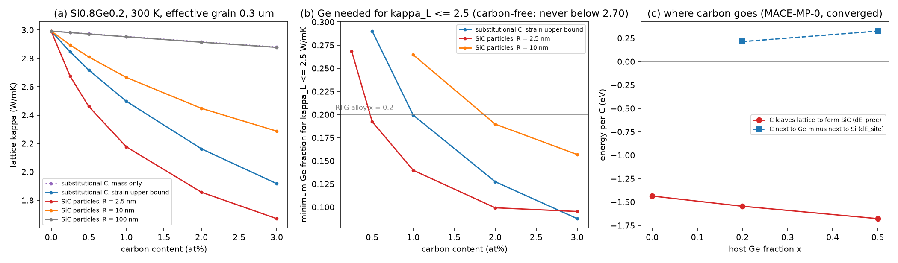

# Nanostructured SiGeC + light doping: results (2026-09-29)

Scope (2026-09-29): the P1 system is nanostructured
**SiGeC** with light doping, not SiGe only. Design `sigec_design.json`
(campaign record seq 46, pushed in `745c84d` before any job); MACE gate outputs
ledgered before analysis (seq 47); gate failure recorded (seq 48); analysis
result (seq 49). CHPC notchpeak-guest array 15892527 (10 tasks, 16 CPUs,
about 45 to 95 min each). grn061 and the DGX were not used.
Numbers: `results/sigec_results.json`, `m1/m1_summary.json`.

## Why the campaign changed shape

The carbon-free campaign (`../nano/`) treated C as a dilute substitutional
dopant. For ball-milled and sintered material that is the wrong default:
equilibrium C solubility in Si is about 6e-6 (Adachi 2007), and the two
sintered SiGe + carbon experiments found through Asta both end with carbon as
**SiC particles**: Zhao et al. 2025 (n-type Si0.8Ge0.2 + P + 0 to 3% SiC,
SiC 100 to 300 nm) and Lu et al. 2025 (p-type Si80Ge20 + B4C, which breaks
down in situ into SiC and B-rich inclusions plus B doping). So carbon is now a
composition axis with two forms, substitutional C and SiC nanoinclusions,
and a MACE stage asks where carbon actually goes.

## Stage M1 (MACE-MP-0 medium): where carbon goes

| Gate | Result |
|---|---|
| M1a lattice constants within 2.5% | **pass**: Si +0.45%, Ge +2.03%, 3C-SiC +0.37% |
| M1b every relaxation at fmax <= 0.01 eV/A, ln a vs y fit R^2 >= 0.9 | **FAIL**: R^2 passes (0.965 / 0.995 / 0.984) but 45 of 57 relaxations hit the 600-step cap with residual fmax 0.010 to 0.089 eV/A |

Per the pre-registered rule the size misfit falls back to modified Vegard
(-0.394) and the M1 energies are **unvalidated** (superseded 2026-09-30 by
stage M1c below: converged, validated, conclusions unchanged). The fallback changes
nothing material: MACE gives -0.392, -0.409, -0.371 at x = 0, 0.2, 0.5, all
within 6% of it.

| x (host Ge) | delta_C | dE_prec per C (eV) | dE_site per C (eV) |
|---|---|---|---|
| 0 | -0.392 | -1.45 | n/a |
| 0.2 | -0.409 | -1.55 (-1.48 to -1.65) | +0.20 (0.14 to 0.25) |
| 0.5 | -0.371 | -1.69 (-1.62 to -1.77) | +0.31 (0.26 to 0.36) |

In materials terms: a substitutional C atom gains about 1.5 eV by leaving the
lattice to form SiC, more so the more Ge the host holds, and it pays 0.2 to
0.3 eV to sit next to Ge instead of Si. The energies are large next to the
error the residual forces plausibly cause (meV to tens of meV), but they stay
flagged until a converged rerun, which needs a new pre-registration.
**Carbon in a sintered SiGe body wants to be SiC, in Si-rich pockets.**

## Predictions (fixed before any run)

| | Prediction | Outcome |
|---|---|---|
| PrC1 | MACE delta_C at x=0 within 30% of modified Vegard | pass (-0.6%), unvalidated (M1b) |
| PrC2 | dE_prec < -0.5 eV at every x, more negative at x=0.5 | pass, unvalidated |
| PrC2b | C avoids Ge neighbours (dE_site > 0) | pass, unvalidated |
| PrC3 | at 1 at% C (x=0.2, 300 K, 0.3 um), 2.5 nm SiC sits between substitutional C at eps=0 and eps=39 | **FAIL**: 2.5 nm SiC (2.18 W/mK) beats substitutional C even at the strain upper bound (2.53); no carbon: 2.99 |
| PrC4 | SiC particles of Zhao's size (R 50 to 150 nm, 3%) lower kappa_L by < 10% at 1023 K | pass: at most 8.9% (R 50 nm, 0.5 um grains); 0.9 to 4.9% at R 100 to 150 nm |
| PrC5 | 1 at% C in its best form reaches carbon-free x=0.2 kappa_L at x <= 0.15 | pass: x = 0.099 (2.5 nm SiC, stiffness contrast) |
| PrC6 | B/P at <= 1e20 on top of SiGeC changes kappa_L < 5% | pass: at most 0.43% |

## What it means for materials

1. **Particle size is the whole carbon lever.** Per 1 at% C in Si0.8Ge0.2 at
   300 K and 0.3 um effective grains: SiC at R = 2.5 nm lowers kappa_L by 13
   to 27% (density vs stiffness contrast), R = 5 nm by 15 to 18%, R = 10 nm by
   11%, R = 25 nm by 5%, and R >= 100 nm by about 1%. Above about 10 nm the two
   contrast bounds agree, so those numbers do not depend on the unknown
   interface stiffness. Substitutional C gives 1% (mass only) to 15% (strain
   upper bound) but, per M1, is not a stable state in sintered material.
2. **Zhao et al.'s kappa drop is not from the SiC particles.** At their
   reported 100 to 300 nm particle size, 3% SiC explains at most about 5% of
   kappa_L (9% even at R = 50 nm) against a measured 20.9% drop in total
   kappa. This independently supports the authors' own attribution to
   nanopores, and it says their carbon was in the wrong size class to act as
   a phonon scatterer.
3. **Carbon can replace germanium, if the SiC stays a few nm.** With 1 at% C
   as 2.5 to 5 nm SiC, the kappa_L of carbon-free x = 0.2 is reached at
   x = 0.10 to 0.13 (300 K; 0.10 to 0.13 at 1100 K), i.e. 35 to 50% less Ge.
   With 3 at% C, x = 0.09 to 0.10. Carbon-free material at 0.3 um grains never
   gets below 2.70 W/mK (300 K) at any x; 3 at% C as 2.5 nm SiC reaches 1.67.
4. **Carbon and grain boundaries compete for the same phonons.** At a nominal
   20 nm grain size, 1 at% C as 5 nm SiC changes kappa_L only from 1.28 to 1.25
   W/mK; at 0.5 um from 3.48 to 2.64. Because real sintered SiGe behaves like
   0.1 to 0.9 um grains (earlier gray-boundary calibration), carbon is useful exactly in the
   microstructure that processing actually delivers.
5. **Light B/P doping is still not a thermal lever** (at most 0.43% on top of
   SiGeC at <= 1e20 cm^-3). It matters for carriers, not phonons.
6. **Screening decision (D4, 0.3 um grains):** lowest kappa_L at x = 0.3 with
   3 at% C as 2.5 nm SiC: 1.52 W/mK at 300 K and 1.46 at 1100 K, against
   2.70 (x = 0.3) and 2.42 (x = 0.5) carbon-free. Imposing the M1 equilibrium
   constraint (carbon as SiC) does not change the answer.

**Processing implication.** The target microstructure is few-nanometre SiC
precipitated in situ from carbon that was forced into the lattice (for
example by mechanical alloying, or B4C decomposition as in Lu et al. 2025)
and then briefly annealed, not SiC powder mixed in at 100 nm and above. M1
says the precipitation is strongly driven, so the practical question is
coarsening kinetics, which this campaign does not model.

## Stage M1c (2026-09-30): converged rerun, energies VALIDATED

Run 2026-09-30 UTC. New pre-registration `m1c/m1c_design.json` (campaign record
seq 53, pushed before submission), CHPC array 15898834 on notchpeak-guest, 51
relaxations (one per task, checkpointed). FrechetCellFilter (hydrostatic) with
FIRE to fmax 0.05, then LBFGS to 0.005. Raw outputs ledgered before analysis
(seq 54). The M1 failure was the optimizer, not the cap: FIRE on the
ExpCellFilter stalled, while FIRE+LBFGS converges every structure in at most
114 steps (under 5 minutes each on 16 cores).

| Gate / prediction | Result |
|---|---|
| M1c-a every relaxation max force <= 0.01 eV/A and abs(p) <= 0.1 GPa | **pass** (51/51; max force 0.0050 eV/A, max abs(p) 0.028 GPa) |
| M1c-b ln a vs y fit R^2 >= 0.9 | **pass** (0.975, 0.999, 0.982) |
| M1c-c bulk lattice constants within 2.5% | **pass** |
| PM2 dE_prec within 0.10 eV of M1 | **pass** (shifts +0.010, +0.008, +0.014 eV) |
| PM3 dE_site > 0, within 0.05 eV of M1 | **pass** (shifts +0.011, +0.020 eV) |
| PM4 delta_C within 5% of M1, x=0 within 30% of Vegard | **pass** (max 1.8%; x=0 is +1.3% vs Vegard) |

| x (host Ge) | delta_C | dE_prec per C (eV) | dE_site per C (eV) |
|---|---|---|---|
| 0 | -0.399 | -1.436 (-1.44 to -1.44) | n/a |
| 0.2 | -0.414 | -1.546 (-1.64 to -1.48) | +0.214 (0.16 to 0.26) |
| 0.5 | -0.371 | -1.678 (-1.77 to -1.60) | +0.326 (0.27 to 0.38) |

Decision (pre-registered rule): **strengthen** on the where-carbon-goes claims
(campaign record seq 55); the "unvalidated" flag of seq 48 is lifted. `analyze_sigec.py`
was re-run on `m1c/m1c_summary.json` (its pre-registered branch now uses the
MACE delta_C per x) into `results/sigec_results_m1c.json`; the original
`results/sigec_results.json` still reproduces bitwise. Only one derived number
moves: the substitutional-C strain upper bound at x=0.2, 300 K, 0.3 um, 1 at% C
goes from 2.533 to 2.497 W/mK (-15.3% to -16.5% vs carbon-free). Every
prediction verdict PrC1-PrC6 is unchanged, as is the D4 screening pick.
`fig_sigec.png` now plots the converged values.

## Limits and next steps

- M1 relaxations were not converged: resolved by stage M1c (above): all
  converged, predictions held, energies validated (campaign record seq 53-55).
- SiC particle scattering is the Rayleigh-to-geometric interpolation (Kim and
  Majumdar 2006; the nanoparticle-in-alloy form of Mingo et al. 2009) with the
  contrast bracketed; at R <= 5 nm the bracket is a factor of about 2 in the
  reduction. An atomistic check (Green's function as in Kundu et al. 2011, or
  MACE-MD with embedded SiC) would close it.
- Pores are not modelled; electron scattering by SiC and pores is not
  modelled, so zT is not claimed.
- The gray boundary remains the known-too-strong model; results are quoted at
  the calibrated effective grain sizes.
