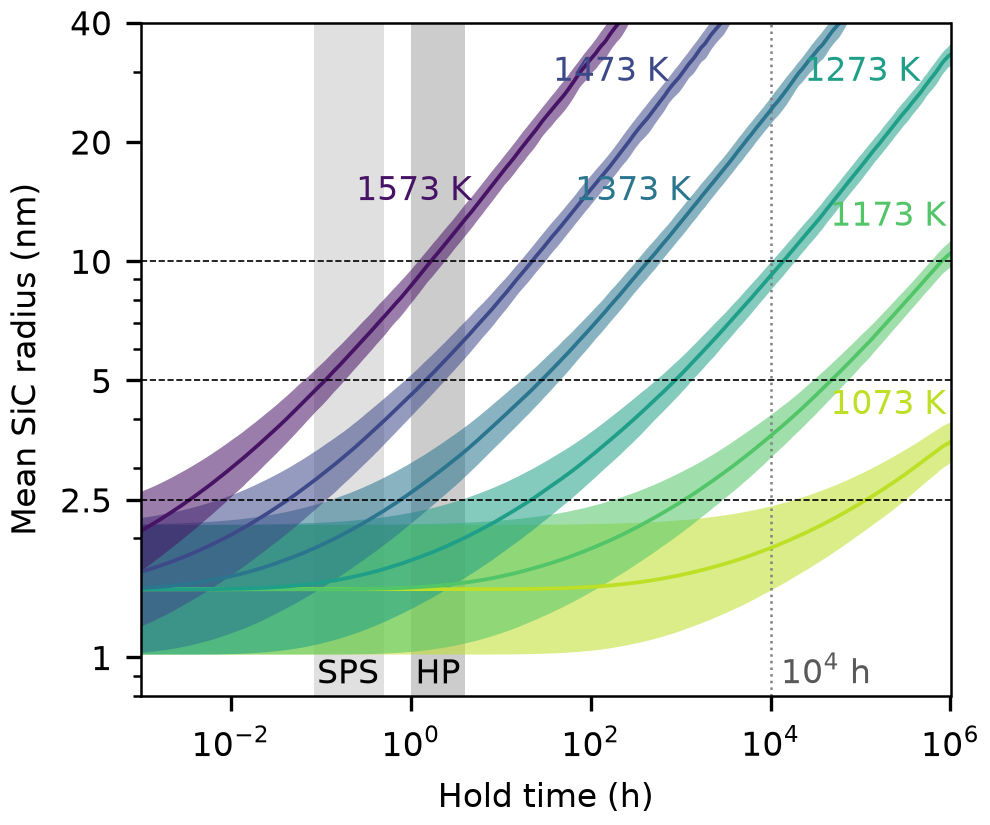

# Coarsening of few-nanometre SiC in sintered SiGe: literature-parameterised estimate

Question (P1 limitation): the P1 recipe needs carbon as 3C-SiC particles of
radius 2.5 to 5 nm in Si(1-x)Ge(x), x = 0.2 to 0.3, at 1 to 3 at% C. Do
particles that start at r0 = 1 to 2 nm stay in that size class through
consolidation (spark plasma sintering, SPS; hot pressing, HP) and through
thermoelectric service?

No new atomistic simulation was run. The estimate is a mean-field Ostwald
ripening calculation (one CPU core, about 15 min in total) whose every input
parameter comes from a DOI-verified source in [`coarsening.bib`](coarsening.bib).

## Files

| File | Content |
|---|---|
| `coarsen_sic.py` | parameters, LSW rate constant, mean-field size-class model |
| `results/coarsening_results.json` | per-temperature parameters, all runs with trajectories, condition summaries |
| `results/run_log.txt` | one line per run (times to 2.5, 5, 10 nm; volume conservation check) |
| `make_figure.py`, `fig_coarsening.png/.pdf` | r(t) bands, 3.3 in wide, 8 pt text |
| `coarsening.bib` | 13 entries, metadata pulled from api.crossref.org |
| `lit/` | Asta MCP search scripts and raw outputs, Crossref verification script and record |

## Model

Carbon reaches a growing particle by diffusion through the matrix, so the
classical volume-diffusion-limited ripening law of Lifshitz, Slyozov and
Wagner (LSW) applies [lifshitz1961; wagner1961]:

    r^3 - r0^3 = K t,   K = 8 sigma D c_e Omega^2 / (9 kT)

with D the carbon diffusivity, c_e the carbon solubility in the matrix,
sigma the SiC/Si interface energy and Omega the volume of SiC per carbon
atom. The Gibbs-Thomson capillary length l = 2 sigma Omega / kT is 3.0 to
4.5 nm between 1573 and 1073 K, i.e. as large as the particles themselves.
The linearised LSW law is then only an asymptote, so the numbers below come
from a mean-field size-class model of Kampmann-Wagner type
[wagner2001kwn] that keeps the full exponential Gibbs-Thomson law,
c(r) = c_e exp(l/r), and conserves the precipitated volume at every step.
Initial size distribution: lognormal, median r0 = 1 or 2 nm, width 0.2 or
0.4 in ln r (a modelling choice, not a literature value). At long times the
model reproduces the LSW radius within about 10%; at the start it coarsens
1.5 to 2.5 times faster than LSW because the smallest particles dissolve
quickly. In this mean-field form the rate does not depend on the carbon
content, so the result holds for 1 and 3 at% C alike.

## Parameters

| Quantity | Value | Source |
|---|---|---|
| Carbon diffusivity in Si | D = 1.9 exp(-3.1 eV/kT) cm^2/s | newman1961 (quoted as 1.99 in goesele2000) |
| | D = 0.95 exp(-3.04 eV/kT) cm^2/s | rollert1989 (as tabulated in werner1998) |
| Substitutional carbon solubility in Si | c_e = 4e24 exp(-2.3 eV/kT) cm^-3 | bean1971 (as given in werner1998 and goesele2000) |
| SiC/Si interface energy | 1.55 to 1.60 J/m^2 (Si(001), semi-coherent, ab initio and Tersoff) | pizzagalli2003 |
| Lattice parameters | a(3C-SiC) = 4.3596 A, a(Si) = 5.4309 A (Omega = a^3/4 = 20.7 A^3) | values quoted in pizzagalli2003 |

Values at the conditions used (from `results/coarsening_results.json`):

| T (K) | D (cm^2/s) | c_e (cm^-3) | c_e (atom fraction) | l (nm) | K_LSW (nm^3/h) |
|---|---|---|---|---|---|
| 1073 | 5.0e-15 to 5.2e-15 | 6.3e13 | 1.3e-9 | 4.3 to 4.5 | 4.5e-6 to 4.9e-6 |
| 1173 | 8.3e-14 to 9.1e-14 | 5.3e14 | 1.1e-8 | 4.0 to 4.1 | 5.7e-4 to 6.5e-4 |
| 1273 | 8.8e-13 to 1.0e-12 | 3.1e15 | 6.3e-8 | 3.7 to 3.8 | 0.033 to 0.040 |
| 1373 | 6.6e-12 to 7.9e-12 | 1.4e16 | 2.9e-7 | 3.4 to 3.5 | 1.1 to 1.3 |
| 1473 | 3.8e-11 to 4.7e-11 | 5.4e16 | 1.1e-6 | 3.2 to 3.3 | 21 to 28 |
| 1573 | 1.7e-10 to 2.2e-10 | 1.7e17 | 3.4e-6 | 3.0 to 3.1 | 290 to 380 |

The rate scales with D c_e, whose combined activation energy is 5.3 to
5.4 eV. A factor of 10 in D c_e therefore moves every time in this README by
a factor of 10, or equivalently shifts the processing window by 60 K at
1273 K and 80 K at 1473 K.

**Not sourced, bracketed.** (1) The interface energy of a curved,
few-nanometre, incoherent SiC particle: the only value found is for the
planar Si(001) interface, and pizzagalli2003 note that no measured value
exists. A sensitivity run with sigma = 1.0 and 2.5 J/m^2 is stored in the
JSON (`sensitivity_unsourced_sigma`); it changes the times to 5 nm by a
factor of about 2 to 3 either way. (2) Carbon diffusivity and solubility in
Si(1-x)Ge(x): no measurement was found; all values are for Si. (3) Carbon
grain-boundary and dislocation-pipe diffusivity in Si: no value was found;
see the threshold argument below.

## Results

Bands span both diffusivity sources, both interface energies, r0 = 1 and
2 nm and both distribution widths. Shaded columns: SPS holds (5 to 30 min)
and HP holds (1 to 4 h); dotted line: 10^4 h of service.

Hold time for the mean radius to reach 2.5, 5 and 10 nm (r0 = 1 to 2 nm):

| T (K) | to 2.5 nm | to 5 nm | to 10 nm |
|---|---|---|---|
| 1073 | 1.8e4 to 3.2e5 h | > 1e6 h | > 1e6 h |
| 1173 | 175 to 2900 h | 2.9e4 to 7.0e4 h | 5.9e5 to > 1e6 h |
| 1273 | 3.5 to 57 h | 515 to 1330 h | 1.0e4 to 1.8e4 h |
| 1373 | 0.12 to 2.0 h | 16 to 45 h | 320 to 580 h |
| 1473 | 25 s to 7 min | 0.8 to 2.4 h | 16 to 31 h |
| 1573 | 2 to 32 s | 4 to 11 min | 1.2 to 2.3 h |

Mean radius after the processing and service holds:

| Condition | r0 = 1 nm | r0 = 2 nm |
|---|---|---|
| SPS 1273 K, 5 / 30 min | 1.1-1.3 / 1.2-1.5 nm | 2.0-2.2 / 2.0-2.3 nm |
| SPS 1373 K, 5 / 30 min | 1.5-1.8 / 1.9-2.3 nm | 2.1-2.4 / 2.3-2.9 nm |
| SPS 1473 K, 5 / 30 min | 2.4-2.8 / 3.4-4.0 nm | 2.7-3.3 / 3.7-4.5 nm |
| HP 1473 K, 1 / 4 h | 4.1-4.7 / 5.7-6.6 nm | 4.3-5.2 / 6.0-7.1 nm |
| HP 1573 K, 1 / 4 h | 7.9-9.0 / 11.7-13.2 nm | 8.2-9.7 / 12.0-14.0 nm |
| Service 1073 K, 1e4 h | 1.5-1.8 nm | 2.1-2.4 nm |
| Service 1173 K, 1e4 h | 3.2-3.6 nm | 3.4-4.1 nm |
| Service 1273 K, 1e4 h | 8.5-9.3 nm | 8.7-10.0 nm |

## Processing window

1. **Consolidation.** SPS at 1373 to 1473 K for 5 to 30 min leaves the mean
   radius at 1.5 to 4.5 nm (table above; corrected 2026-10-11 from "2 to 4.5 nm"),
   mostly inside the 2.5 to 5 nm target, with the shortest 1373 K hold just below it; SPS at 1273 K
   barely coarsens 1 nm particles, so they stay below the target size. HP at
   1473 K for 1 h is at the upper edge (4 to 5 nm); HP for 4 h at 1473 K, or
   any HP hold at 1573 K, gives 6 to 14 nm, where P1's own model gives about
   11% kappa_L reduction per at% C at R = 10 nm against 13 to 27% at 2.5 nm.
2. **Service.** Coarsening, not consolidation, sets the binding limit. For
   10^4 h the particles stay below about 4 nm at a 1173 K hot side and below
   2.5 nm at 1073 K, but reach 8.5 to 10 nm at 1273 K. The few-nanometre
   SiC recipe suits legs whose hot side stays near or below 1173 K.

## Mechanisms that could invalidate the estimate

- **Grain-boundary and pipe diffusion (most likely failure mode).** Sintered
  SiGe behaves like 0.1 to 0.9 um grains, and milled powder carries
  dislocations. A particle sitting on a boundary is fed by boundary transport
  when delta D_b > r D_l (delta about 0.5 nm), i.e. when the boundary
  diffusivity exceeds the lattice value by only 5 to 20 times; ripening of
  boundary particles then follows the faster r^4 law [kirchner1971], and
  dislocation pipes act likewise. No carbon boundary diffusivity in Si was
  found, so this is not computed. Geometry gives the exposed share: at 1 at%
  C and r = 2.5 nm the particle spacing is about 18 nm (13 nm at 3 at%), and
  the share of particles within one spacing of a boundary is roughly 4
  lambda / L (stereological S_v = 2/L): about 75%, 25% and 8% for mean
  intercepts L = 0.1, 0.3 and 0.9 um. In the finest-grained material most
  particles are exposed, so the times above are upper bounds there.
- **Ge effect on carbon transport and solubility.** All parameters are for
  Si. Si and Ge self-diffusion in relaxed Si(1-x)Ge(x) rises with x, with a
  growing vacancy share [kube2010], whereas carbon in Si moves almost
  entirely by an interstitial-mediated route [goesele2000], so the Ge effect
  on carbon cannot be inferred from self-diffusion. A factor of 10 either way
  shifts the window by 60 to 80 K (see Parameters). The project's own MACE
  stage M1 (not a literature value, not used here) finds that carbon pays
  0.2 to 0.3 eV to sit next to Ge, which would lower c_e and slow coarsening
  in SiGe.
- **Vacancy supersaturation from milling.** Carbon diffusion scales with the
  self-interstitial concentration [goesele2000], and SiC precipitation needs
  self-interstitial absorption because of the volume shrinkage, so the
  effective SiC solubility scales inversely with it [taylor1993;
  goesele2000]. A uniform interstitial undersaturation (for example set by
  excess vacancies) therefore lowers D and raises c_e by the same factor and
  leaves D c_e, and the ripening rate, unchanged to first order. The
  interstitial transport capacity D_I C_I* exceeds D c_e by 770 to 1200
  times at 1273 to 1473 K (werner1998, Table I values), so point defects
  re-equilibrate between neighbouring particles much faster than carbon
  does. Non-uniform effects remain: interstitial sinks at boundaries and
  dislocations, and the reluctant nucleation of SiC [taylor1993], which this
  estimate does not treat (it assumes SiC particles already exist at r0).
- **Other model limits.** Interface-reaction control would add a series
  resistance and slow coarsening, so the diffusion-limited times are lower
  bounds in that respect. A finite volume fraction (1 to 3%)
  raises the ripening rate modestly above the mean-field value [ardell1972];
  no correction was applied. Elastic misfit (20%) and particle shape are
  absorbed into the single interface energy.

## References (all checked against Crossref on 2026-10-04)

| Key | DOI | Used for |
|---|---|---|
| lifshitz1961 | 10.1016/0022-3697(61)90054-3 | LSW ripening law |
| wagner1961 | 10.1002/bbpc.19610650704 | LSW ripening law |
| wagner2001kwn | 10.1002/352760264x.ch5 | mean-field size-class (Kampmann-Wagner) method |
| newman1961 | 10.1016/0022-3697(61)90032-4 | carbon diffusivity in Si |
| rollert1989 | 10.4028/www.scientific.net/msf.38-41.753 | carbon diffusivity in Si (radiotracer) |
| bean1971 | 10.1016/s0022-3697(71)80179-8 | carbon solubility in Si |
| werner1998 | 10.1063/1.122483 | tabulated D, c_e, point-defect parameters (secondary) |
| goesele2000 | 10.1557/proc-610-b7.11 | review: D, c_e, interstitial mechanism, precipitation physics |
| taylor1993 | 10.1063/1.109063 | high interface energy and volume shrinkage of carbon precipitation |
| pizzagalli2003 | 10.1103/physrevb.68.195302 | SiC/Si interface energy, lattice parameters |
| kirchner1971 | 10.1007/bf02813264 | grain-boundary precipitate coarsening (r^4) |
| ardell1972 | 10.1016/0001-6160(72)90114-9 | volume-fraction effect on coarsening |
| kube2010 | 10.1063/1.3380853 | composition dependence of self-diffusion in SiGe |

Parameter values were read from the full text of werner1998 and
goesele2000 (open copies at the MPI Halle publication server) and from Asta
snippet search of pizzagalli2003; the 1961, 1971 and 1989 originals were not
opened, and their values are taken as tabulated in werner1998 and
goesele2000.

## Reproduce

    ~/mat_theory_pilot/venv/bin/python coarsen_sic.py    # about 15 min, 1 core
    ~/mat_theory_pilot/venv/bin/python make_figure.py
    ~/mat_theory_pilot/venv/bin/python lit/verify_crossref.py   # rewrites coarsening.bib
