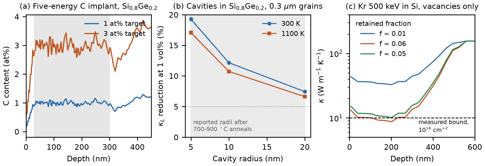

# Implant routes to the recommended SiGeC microstructures (2026-10-12)

Run 2026-10-12: three SRIM studies: (1) a He cavity recipe with a consistency
check, (2) a carbon implant recipe for in-place SiC, (3) the damage-to-kappa
chain with a validation gate.

## Order of steps
1. `implant_design.json` (recipes, literature anchors, gates G0-G1, predictions
   PI1-PI7, decision rules) hashed onto the campaign record by `preregister_implant.py`
   (seq 151) and pushed (`eab8739`) before any SRIM run.
2. `run_srim.py`: 13 TRIM runs on sparksone (SRIM-2013, quick Kinchin-Pease,
   5000 ions; Kr 2000), 26-64 s each. One run stalled with no CPU use and was
   restarted; `run_srim.py` now kills and retries a stalled TRIM after 300 s.
   `rustbca_crosscheck.py`: 4 RustBCA ranges on the DGX (29 s, 4 threads).
3. `commit_raw.py`: 57 raw files hashed onto the campaign record (seq 152), pushed
   (`cea3adf`) before analysis.
4. `analyze_implant.py` (run once, seconds) -> `implant_results.json`;
   `apply_implant_decision.py` -> campaign record seq 153 (analysis), 154 (cavity
   scope-limit), 155 (SiC route claim), 156 (chain usability claim).
5. `make_implant_figure.py` -> `fig_implant.png/.pdf`.

Literature anchors come from Asta snippet searches q120-q135 (`asta/`).

## Gates
| Gate | Result |
|---|---|
| G0 SRIM vs RustBCA mean range within 15% | pass: He/Si 40 keV +10.4%, He/SiGe 40 keV +11.9%, C/SiGe 40 keV +10.7%, Kr/Si 500 keV -4.2% |
| G1 SRIM Rp(He 50 keV, Si) within 10% of 450 nm | pass: 416 nm (-7.5%) |

## Predictions
| | Result | Verdict |
|---|---|---|
| PI1 bubble dose rule reproduces the 100 keV threshold window | 0.95e16 cm-2 vs measured 1-2.5e16 | held |
| PI2 vacancy budget allows 1 vol% at <= 6% survival | needs 0.23% survival (1% survival would give 4 vol%) | held |
| PI3 R = 20 nm cavities still a lever (>= 5%) | 6.6-7.4% reduction | held |
| PI4 coarsening to R = 20 nm costs part of the Ge saving | 18.4% saving vs 40% at R = 5 nm | held |
| PI5 five-energy C box within 15% rms | 5.9% rms (max 15.7%) over 30-300 nm | held |
| PI6 1 at% C recipe amorphises the layer | 7.6 displacements per atom at the peak | held |
| PI7 point vacancies cannot reach the measured Kr bound at plausible survival | they can: f = 0.050 reaches 10 W/mK | refuted |

## Decisions
- **Cavities (scope-limit, seq 154).** The 40% Ge saving of the light-dopant
  campaign assumed R = 5 nm. Reported cavity radii after 700-900 C anneals are
  5-20 nm; at R = 20 nm the saving is 18% and the reduction 7%. The 40% figure
  now holds only if cavities stay at R <= 10 nm (anneal and service below the
  coarsening range); at the coarsened size cavities remain a lever.
  Recipe: He 40 keV, about 5e16 cm-2 into Si0.8Ge0.2, cavity layer about
  220-410 nm. The bubble threshold dose is about 7e15 cm-2 at 40 keV.
- **SiC route (claim, seq 155).** C at 10, 20, 40, 80, 160 keV with doses
  1.1, 1.6, 3.6, 6.4, 13.1e15 cm-2 (total 2.6e16) gives 1 at% over 30-300 nm
  (3 at%: three times each dose). The layer amorphises, so the route is
  implant, then solid-phase regrowth and precipitation. 1 at% C (4.9e20 cm-3)
  is above the 2-4e20 cm-3 substitutional cap reported after regrowth, so the
  excess is expected to leave the lattice as SiC, the form the campaign
  recommends; the literature also reports defective regrowth above that cap.
  SiC particle size after the anneal is not computed.
- **Damage-to-kappa chain (claim, seq 156).** With the measured Kr bound
  (crystalline region <= 10 W/mK at 1e14 cm-2), point vacancies need a retained
  fraction of at least 5%. The bound is one-sided, so the chain is usable for
  as-implanted estimates with f in [0.05, 0.1] stated as the weak input, but it
  cannot decide whether point defects or the amorphous pockets the authors
  observed set the measured value. A measured kappa at a sub-amorphising dose
  would turn this bound into a test.

## Limits
SRIM treats the target as amorphous at 0 K (no channelling, no dynamic
annealing, fixed composition); C 10 keV transmitted 0.7% of ions through the
75 nm target, which slightly underweights its tail. Cavity number density and
size distribution are anchored to the literature, not computed. Implanted
layers are 0.1-1 um deep, so these routes make a surface layer or film, not a
sintered leg.

